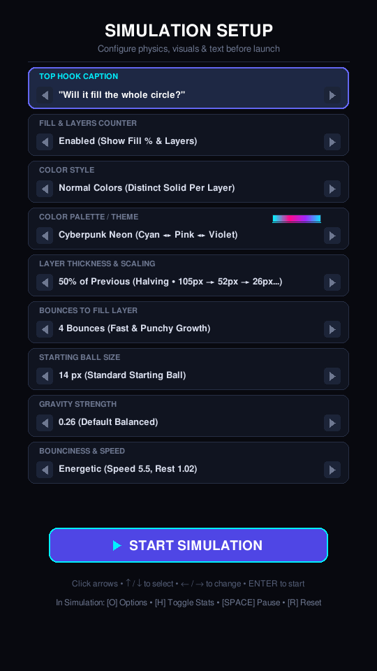
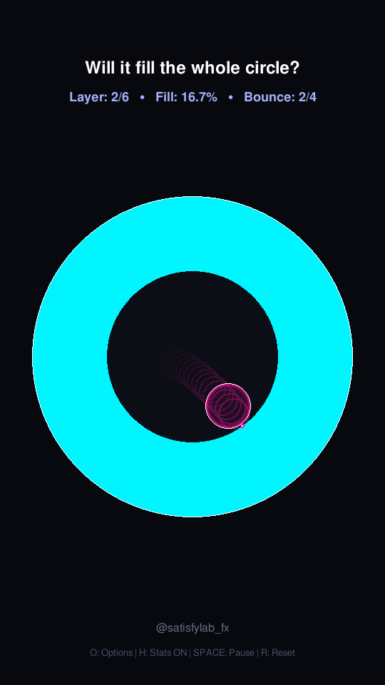
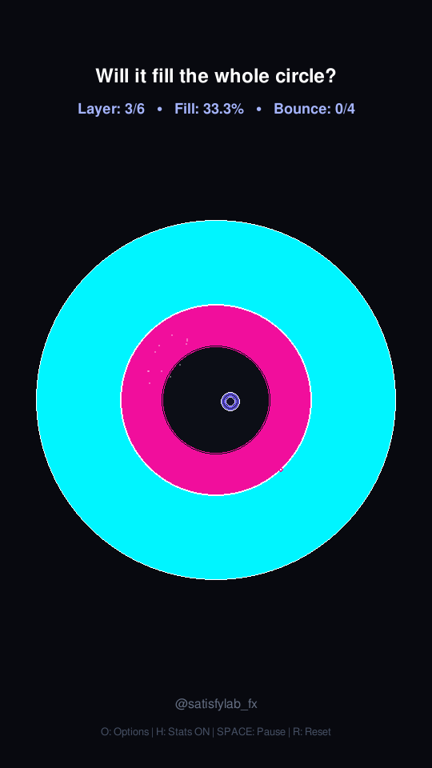
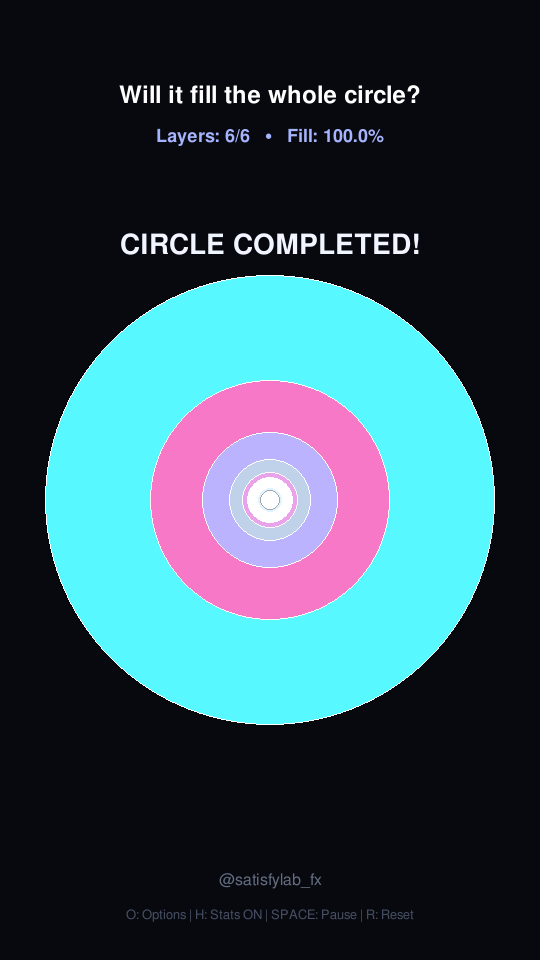

# 🔮 Viral Growing Bouncing Rings Simulation

An ultra-satisfying, physics-driven 9:16 vertical video simulation built in **Python**, **Pygame**, and **NumPy**. Inspired by viral Instagram Reels and TikTok satisfying physics simulations, a glowing neon ball ricochets inside a circular arena, grows with every bounce to fill its layer, locks concentric rainbow rings inward, and respawns dynamically until the entire arena is filled.

---

## 📸 Screenshots

| Simulation Setup Menu | Active Growing Ball |
| :---: | :---: |
|  |  |

| Layer Lock & Shockwave | Completed Concentric Rings |
| :---: | :---: |
|  |  |

---

## ✨ Key Features

- **Concentric Ring & Ball Growth Physics**:
  - The ball inflates dynamically on every collision against the arena wall.
  - When the target bounce count is reached, the current band locks into a permanent glowing ring.
  - An expanding radial shockwave ripples across the locked band.
  - A new ball spawns at a random location within the remaining free space.
  - **Randomized Impulse**: On every spawn and respawn, the ball is launched in a **random 360° direction** at a **randomized speed**, ensuring fresh trajectories every round.

- **Flexible Layer Thickness & Scaling Presets**:
  - **50% of Previous (Halving)**: Exponential geometric inward decay (105px → 52px → 26px → ...).
  - **65% Decay**: Balanced geometric progression.
  - **80% Decay**: Smooth, subtle inward thinning.
  - **130% Growth**: Inverted progression (thin outer bands growing into thick inner rings).
  - **Constant Thickness**: Fixed 15 px, 25 px, or 35 px bands.

- **Vibrant Color Modes & 16 Curated Palettes**:
  - **Normal Colors**: Golden-ratio distributed contrasting solid color per layer.
  - **Gradient**: Smooth multi-stop color progression across concentric layers.
  - **16 Palettes**: Cyberpunk Neon, Neon Rainbow, Cotton Candy, Synthwave Sunset, Electric Emerald, Sunset Blaze, Royal Amethyst, Matrix Cyber, Hot Pink & Cyan, Gold & Royal Blue, Toxic Lime & Violet, Pastel Dream, Crimson & Obsidian, Ocean Depths, Solar Flare, Vaporwave 80s.
  - Real-time color swatches in the options menu.

- **Interactive Pre-Launch Options Menu**:
  - 9 customizable parameters (Hook caption, stats counter, color style, palette, thickness plan, bounces per layer, initial ball size, gravity, bounciness & speed).
  - Full mouse click and keyboard arrow navigation.

- **Procedural Audio Synthesizer**:
  - 100% self-contained sound effects generated procedurally with NumPy (sine wave chimes, harmonic overtones, ADSR envelope, celebration chord).
  - Zero external `.wav` or `.mp3` dependencies.

- **Content Creation & Recording Tools**:
  - Native 9:16 vertical resolution: `540x960` preview, with `SCALE_FACTOR = 2` for `1080x1920` Full HD export.
  - Instant PNG frame recording via <kbd>V</kbd> key for assembling reels with FFmpeg.
  - Configurable top curiosity hook caption and live HUD counter.

---

## 🎮 Controls & Shortcuts

| Key | Action |
| :--- | :--- |
| <kbd>O</kbd> | Toggle between **Options Menu** and **Simulation** |
| <kbd>H</kbd> | Toggle HUD statistics (Layer, Fill %, Bounces) on/off |
| <kbd>SPACE</kbd> | Pause / Resume simulation |
| <kbd>R</kbd> | Reset simulation with randomized ball placement and velocity |
| <kbd>UP</kbd> / <kbd>DOWN</kbd> | Dynamically adjust gravity in real time |
| <kbd>M</kbd> | Mute / Unmute procedural sound effects |
| <kbd>V</kbd> | Start / Stop saving PNG frames to `./output_frames` |
| <kbd>ESC</kbd> | Quit application |

---

## 🚀 Quickstart

### Prerequisites
- Python 3.10+
- Pygame & NumPy

### Installation
```bash
git clone https://github.com/KareemHussen/VisualBall.git
cd VisualBall
pip install -r requirements.txt
```

### Running the Simulation
```bash
python3 growing_rings_reel.py
```

---

## 🎥 Exporting to Video (Optional)

1. Press <kbd>V</kbd> while running the simulation to start recording frames into `./output_frames/`.
2. Press <kbd>V</kbd> again when the circle completes to stop recording.
3. Assemble into a 60 FPS MP4 video using FFmpeg:
```bash
ffmpeg -framerate 60 -i output_frames/frame_%05d.png -c:v libx264 -pix_fmt yuv420p visual_ball_reel.mp4
```

---

## 📄 License

MIT License. Free for creative coding, experimentation, and social media reels.
